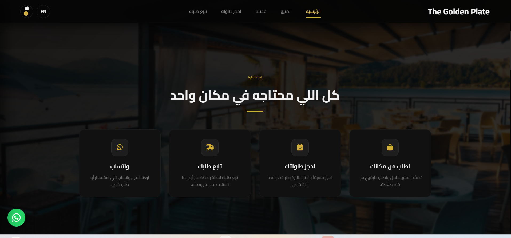
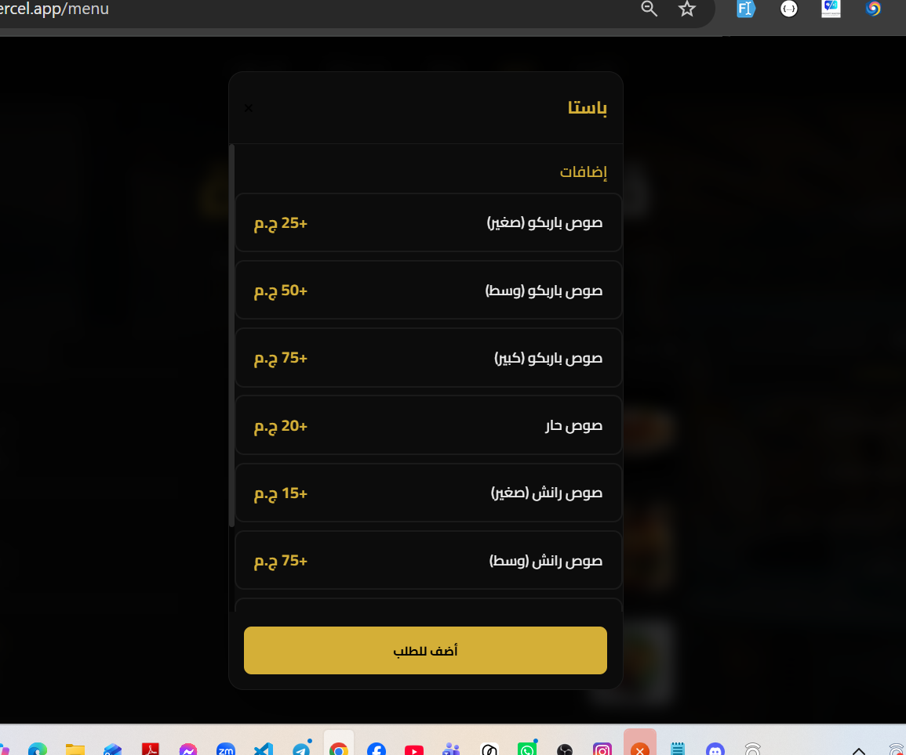
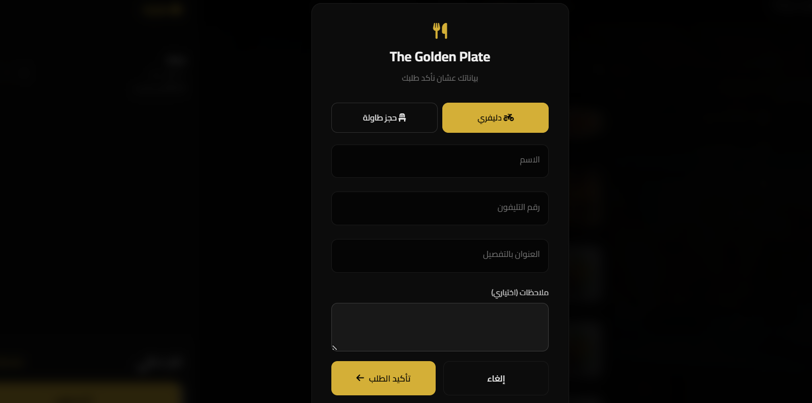

# The Golden Plate

A bilingual (Arabic / English) restaurant website and ordering system: browse the menu, order for delivery, book a table, track your order, and manage everything from an admin panel.

**Live demo:** https://the-golden-plate.vercel.app

## Screenshots

| Home | Extras modal | Checkout |
|------|--------------|----------|
|  |  |  |

## Features

**Customer site**
- Menu with categories, search, item sizes, and per-product extras (extras can have their own sizes and prices)
- Cart with automatic price calculation
- Delivery orders and table reservations through a single checkout flow
- Order confirmation sent to the restaurant via WhatsApp
- Live order tracking by phone number (auto-refreshes every 30 seconds)
- Customer reviews tied to completed orders
- Arabic / English with full RTL support
- Responsive layout and splash screen

**Admin panel**
- Dashboard and analytics (revenue, orders, weekly sales)
- Orders and reservations with status updates and a WhatsApp button to contact the customer
- New-order sound alert
- Menu management: add, edit, hide products, upload images, link extras to products
- Extras, categories, customers and reviews management

## Tech stack

- **Framework:** Next.js 16 (App Router, Turbopack) with TypeScript
- **State and data:** Redux Toolkit (cart), TanStack Query, Axios
- **Forms and validation:** react-hook-form with Zod
- **Backend:** a separate Laravel REST API (not part of this repository)
- **Hosting:** Vercel

## Getting started

```bash
npm install
npm run dev
```

Create a `.env.local` file in the project root:

```env
API_URL=https://your-backend-url/api
```

In the browser, requests go through a Next.js route handler (`/api/remote/...`) that proxies to `API_URL`.

Open http://localhost:3000.

### Scripts

| Command | Description |
|---------|-------------|
| `npm run dev` | Start the dev server |
| `npm run build` | Production build (includes type checking) |
| `npm run start` | Run the production build |

## Notes

- The frontend was built against a Laravel API developed by a teammate. The API contract (products, sizes, extras, orders) is documented through its Postman collection.
- Written in strict TypeScript with no `any` types.